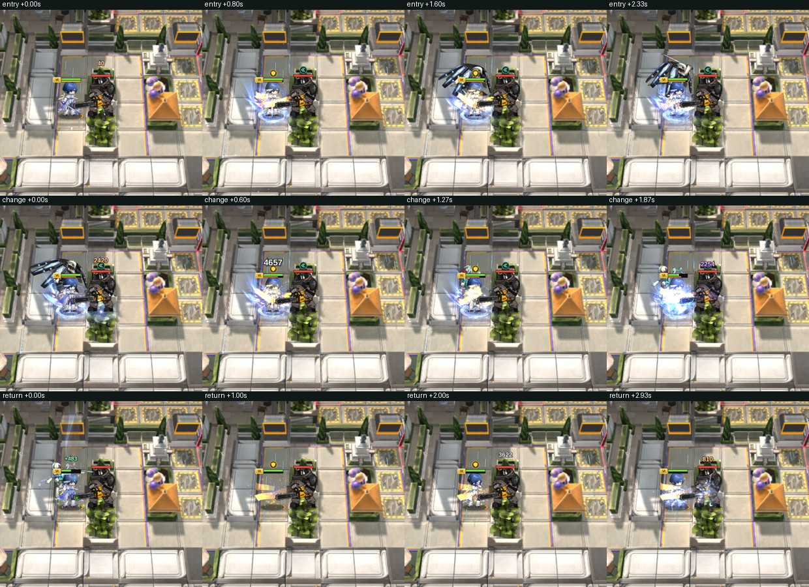
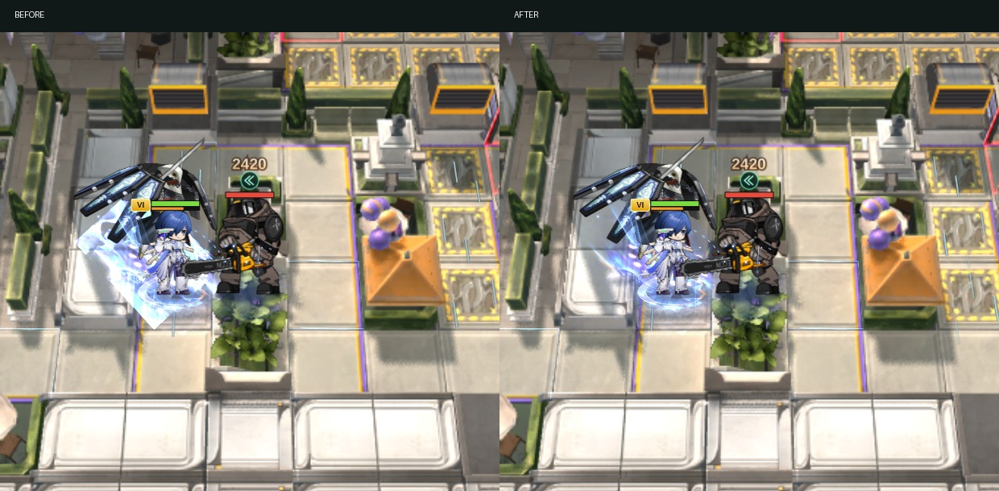

# 유키 마코토: 원본 영상과 실제 전투 재검증

이전에는 렌더러에 전환 입력을 직접 넣은 테스트로 완료를 보고했다. 실제 전투 이벤트 순서와 원본 영상 비교가 빠져 있었으며, 그 판단을 정정한다.

| 항목 | 실제 문제 | 수정·확인 결과 |
|---|---|---|
| 본체 → 대역 | 본체가 소환기를 드는 SwitchOut이 누락되고 페르소나 SwitchIn부터 재생됨 | SwitchOut 1초 → 각 스킬 SwitchIn 1초를 순서대로 재생. 진입 후 대역 20초를 적용 |
| 대역 → 대역 | 기존 ChangeBegin/ChangeEnd 연결 경로를 실제 전투에서 재확인 | 3스킬 ChangeBegin 0.5초 → ChangeEnd 1초 → P2 Loop. 두 대역은 종료 시각을 공유하며 시간을 새로 부여하지 않음 |
| 대역 → 본체 | 페르소나별 SwitchOut이 누락되어 총공격으로 바로 넘어감 | 각 페르소나 SwitchOut 1초 → 총공격 Loop/End → 본체. 종료 모션 반복 없음 |
| 사진의 사각형 이펙트 | 스킨 오라의 flow fire Quad가 사용하는 ZDistort/Disturb(CustomData) 셰이더에서 _RamTex 마스크를 읽지 않았음 | 기존 마스크 대응 셰이더로 연결. 효과를 축소·삭제하지 않고 원래 마스크/음수 tiling 유지. 같은 전투 시점의 수정 전후에서 노출된 사각형 제거 확인 |

## 원본 영상 대조

사용자가 제공한 영상의 진입 약 3.3–5.3초, 복귀 약 25.2–27.8초, 3스킬 전환 약 72–73.5초 구간과 추출한 애니메이션 길이·순서를 대조했다. 카메라가 이동하므로 원본 발췌는 전체 화면을 유지했다. 전투 배치와 외형은 원본 촬영과 다르며 픽셀 일치를 주장하지 않는다.

| 전환 | 원본 발췌 | 실제 게임 기본 외형 | 실제 게임 스킨 |
|---|---|---|---|
| 본체 → 대역 | [원본](reference-entry.mp4) | [촬영](base-entry.mp4) | [촬영](skin-entry.mp4) |
| 대역 → 대역 | [원본](reference-change.mp4) | [촬영](base-change.mp4) | [촬영](skin-change.mp4) |
| 대역 → 본체 | [원본](reference-return.mp4) | [촬영](base-return.mp4) | [촬영](skin-return.mp4) |

## 사진의 사각형 경계

스킨의 makoto_skill_03_p1_buff_01_l_p3r#1 / r_p3r#1에서 재현. 왼쪽 flow fire 노드 18 등의 _RamTex 가장자리 투명도가 누락되어 기울어진 사각형이 그대로 드러났다. 이전에 점검한 캐시 경계 문제와는 다른 원인이었다. 동일 셰이더를 사용하는 219개 재질 중 85개는 실 마스크/램프 텍스처를 사용하고, 134개는 기본 흰색을 사용한다. 다른 셰이더 계열은 변경하지 않았다.

## 검증 방식과 결과

- S1/S2/S3 × 기본/스킨 6개 전투를 서버 시뮬레이션으로 기록하고 실제 processEvents → syncBattle → UnitView 경로로 재생·촬영. 렌더러에 전환 이벤트를 따로 주입하지 않음.
- 실제 기록: 진입 3.667초, S3 두 번째 대역 전환 9.033초, 복귀 시작 25.667초, 총공격 26.667초, 본체 복귀 28.267초.
- 전환 시작 클립의 첫 관측 재생 시각은 0.033–0.067초(관측 틱 범위). 진입 SwitchOut/각 SwitchIn, ChangeBegin/End, 복귀 SwitchOut/총공격 End의 순서를 확인. [전체 추적 기록](battle-feed-validation.json).
- 촬영은 실제 게임 렌더러의 15fps 캡처. 시간축은 기록된 전투 시간으로 구동하며 캡처 구간 외 정적 맵 렌더를 생략했다. 브라우저 오류 0개.
- 관련 테스트 65개 통과, 실패·생략 0개. 인형사 은신 처리 비교와 제국 드론 표적 고정 회귀 테스트 포함.
- 수정 파일 ESLint 오류 0개, 기존 경고 5개. 전체 테스트 묶음은 재실행하지 않음.
- 재배치 판정이나 카제마루와의 은신 처리 규칙은 변경하지 않음. 벽에 가려지는 방식도 변경하지 않음.

커밋·푸시·배포하지 않았으며 로컬 서버에 반영했다.

## 후속 수정: 배치·전환 중 공격과 지속시간 표시

- 원본 클라이언트 `content/custom/makoto/official.json`의 특성 blackboard `duration=20` 및 원문 설명의 20초를 확인했다.
- 배치 모션 잔여 시간이 행동 가능 판정에서 빠져 있던 부분을 복구했다. 일반 공격 직전 자동 스킬 발동 후에도 공격을 계속 준비하던 경로는 발동 후 행동 가능/무장해제 상태를 다시 확인한다.
- 전환 Buff가 끝나는 틱과 전환 완료 콜백 사이에도 마코토의 전환 상태 자체로 공격을 차단한다. 진행 중 공격 준비는 진입 시 취소한다.
- 기존 종료 시각은 이미 진입 2초+대역 20초였으나 바의 최대값을 22로 전달했다. 최대값을 20으로 수정해 진입 중에는 20을 유지하고 완료 후 감소한다. S3 대역 간 전환은 기존 공통 종료 시각을 유지한다.
- 후속 관련 테스트 55개 통과. 별도 확장 실행의 기존 `round40-attack-commit` 적 swing 테스트 3개는 이번 수정 전 코드를 로더로 복원한 실행에서도 동일하게 실패했다. 기대값을 바꾸지 않았다.
- 기본/스킨 6개 전투를 재기록하여 전환 중 atkStart/atk 이벤트가 없음을 확인했다. [이벤트 감사 기록](attack-transition-audit.json). 위 영상은 이전 촬영으로, 이 후속 수정의 새 촬영이라고 주장하지 않는다.
