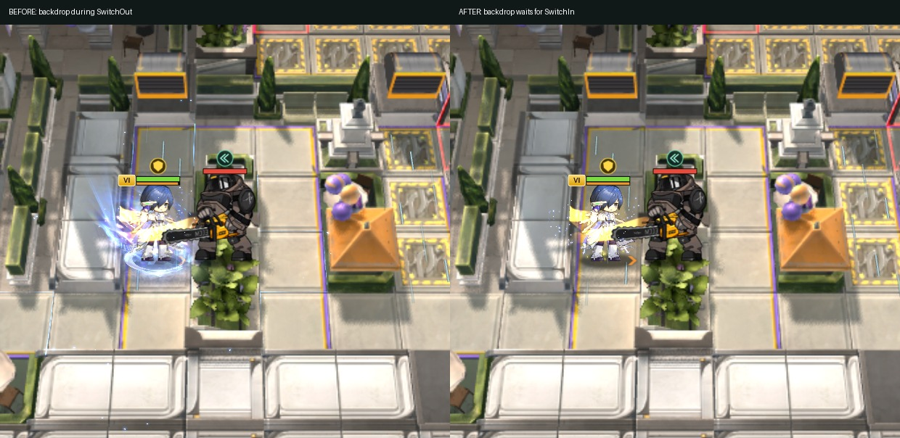
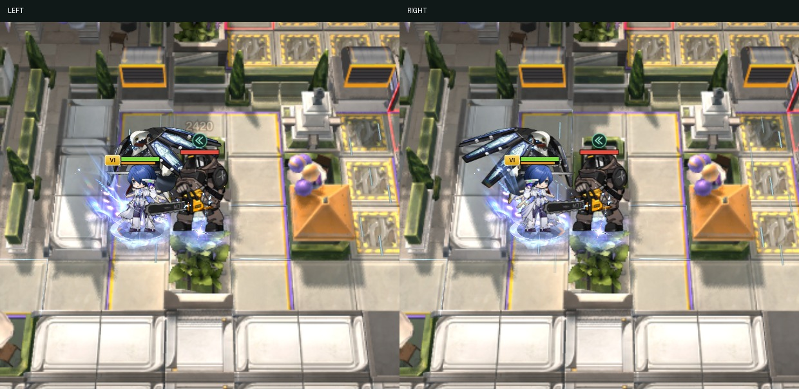

# 마코토 복귀 후 공격·진입 배경·방향 후속 검증

| 제보 | 원인 | 수정 |
|---|---|---|
| 본체 복귀 후 서 있음 | P2에서 추가한 noAttack이 Object.assign으로 본체 설정을 덮어써도 남았음. 대역의 공격 대기시간도 남았음 | 본체 프로필을 새로 복원하고 공격 대기시간을 초기화. S1/S2/P1/P2 복귀 경로 테스트 |
| 복귀 후 첫 공격 모션 누락 | 복귀·첫 공격이 같은 이벤트 묶음에 오면 화면의 마지막 change 틱이 남아 beginAttack을 거절할 수 있음 | 마코토의 권위 있는 복귀 이벤트에서 전환 잠금을 해제한 뒤 첫 공격 수신 |
| 진입 배경이 처음부터 나타남 | 본체 SwitchOut 시작부터 Stand 모드를 선택해 대역 배경 루프를 켰음 | SwitchOut 1초 동안 Default, 해당 SwitchIn 구간부터 Stand. S3 P1→P2도 ChangeBegin 이후 ChangeEnd에 맞춰 P2 효과 선택 |
| 방향이 달라도 같은 배경 | cold load 시 SwitchableRightEffect 선택을 놓치면 기존 루프가 유지됨. 방향 변경에도 이미 재생 중인 효과를 재선택하지 않음 | 원본 좌우 분기에 맞춰 로딩 완료와 방향 변경 때 루프 재선택. 자신에게 붙이는 전환 효과는 자기 자신을 타격 방향으로 계산하지 않음 |

진입 클립 순서는 원본 추출 데이터의 common ability와 영상에서 확인한 `SwitchOut → Doll_Skill_n_SwitchIn`을 유지한다. 기본/스킨 Back 모델에는 SwitchOut/SwitchIn 클립이 없으므로 원본 Front 전환을 사용하며 별도 상하 전환 모션을 만들지 않았다.

## 실제 전투 촬영

| 구간 | 기본 외형 | 스킨 |
|---|---|---|
| 본체 → 대역 | [영상](base-entry.mp4) | [영상](skin-entry.mp4) |
| 대역 → 대역 | [영상](base-change.mp4) | [영상](skin-change.mp4) |
| 대역 → 본체 및 첫 공격 | [영상](base-return.mp4) | [영상](skin-return.mp4) |

- 실제 서버 전투 이벤트를 렌더러에 재생했다. 기본/스킨 모두 28.067초 복귀 이벤트 직후 Attack_B, 이후 Attack_A/B를 확인했다. [전투 추적](battle-feed-validation.json).
- SwitchOut 구간 3.533–4.333초에는 대역 buff 배경이 없고, SwitchIn 이후 4.533초 관측부터 해당 방향의 배경이 재생된다.
- 방향 비교는 같은 전투를 정지한 뒤 실제 렌더러에서 RIGHT → LEFT → RIGHT로 전환하여 촬영했다. 서버가 이 도중 방향을 바꾼 전투 녹화는 아니다. [방향 검사](facing-validation.json). 멈춘 효과의 잔여 입자는 자연 소멸하므로 목록에 잠시 함께 남을 수 있다.
- 관련 테스트 70개 통과, 실패·생략 0개. ESLint 오류 0개, 기존 경고 7개.
- 원본 클라이언트 특성 duration=20. 본체→대역 2초를 제외한 대역 시간이며 두 대역의 남은 시간은 공유한다.

커밋·푸시·배포 없이 로컬 서버에 반영했다.
