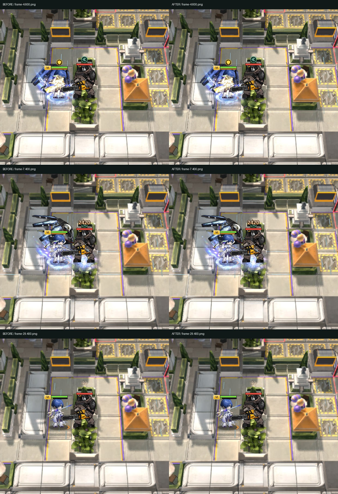

# 추가 성능 경로 점검 및 동작 동일성 검토

2026-10-24. 앞선 [전투 시작·마코토 성능 수정](../battle-performance-2026-10-24/README.md)에 이어 검사한 내용이다. 코드·리소스 준비의 중복을 줄이되 전투 규칙·시각 효과 품질을 유지하는 범위다. 커밋·푸시·운영 반영 없음.

## 남긴 수정

| 경로 | 기존 비용 | 수정 | 동일성 확인 |
|---|---|---|---|
| 상태별 모델 스킨 | 매 프레임 상태 별칭 배열을 새로 만들고 기본 스킨만 있는 모델도 상태 스킨 검색 | 고정 별칭 공유. 기본 스킨만 있는 것이 현재 데이터에서 확인될 때만 불필요 검색 생략 | 목록을 매번 확인하므로 스킨 추가/교체를 놓치는 캐시를 만들지 않음. 상태 스킨 10,000조건 비교 |
| 공식 상태 효과 | 상태 없는 유닛도 임시 배열과 Set 여러 개 생성 | 상태가 없고 이전 상태도 없을 때만 빠르게 반환. 상태가 있으면 기존 순서로 검사 | 상태 시작/해제, 사망/다운/준비, 소환물 무적, 죽은 효과 재시작을 포함한 10,000조건 비교 |
| 재능 유지 효과 | loop/start/range를 새 배열로 합친 뒤 다시 filter 배열 생성 | 같은 원본 배열을 순회하여 필요한 결과 배열 하나만 작성 | 순서·중복·사후 효과 제외·실행 중 계획 변경 5,000조건 비교. 장기 캐시로 고정하지 않음 |
| 유닛 부착 효과의 표시 순서 | 이미 마지막 자식인 이펙트 레이어에도 매 프레임 addChild 호출. PIXI는 기존 자식도 제거/추가함 | 실제 부모/순서가 바뀐 경우만 addChild | 모델·상태·HUD 순서 500프레임 비교. 새 HUD가 뒤에 추가되면 기존처럼 재정렬. 효과 종료 시 기존처럼 제거 |
| 이전 경계 캐시의 무효화 | 상태 스킨이 바뀌면 애니메이션이 정지 중이어도 표시 영역이 바뀔 수 있음 | 실제 상태 스킨 적용 때 포즈 버전을 올려 새 경계 측정 | 빙결 스킨을 정지된 모션에 적용하는 회귀 검사 추가. 상태 표시 생략으로 최적화하지 않음 |

## 전후 비교 과정

1. 이번 추가 수정 직전의 네 모듈을 별도 사본으로 보관했다.
2. 같은 고정 난수 시퀀스로 기존 함수와 수정 함수를 실행했다. 상태별 모델의 합성 결과, 상태 효과 시작/종료 로그, 유지 효과 목록, 렌더 그룹·순서·자식 순서를 직렬화했다.
3. **25,500조건의 SHA-256이 전부 동일**했다. [전](comparison-before.json), [후](comparison-after.json). 검사 코드는 [tools/audit-render-performance.mjs](../../tools/audit-render-performance.mjs)이며 파일을 읽거나 전투 상태를 바꾸지 않는 진단 도구다.
4. 실제 Chromium/SwiftShader 렌더러에서 같은 전투 기록의 5개 시점을 전후 촬영했다. 초기 자동 품질 갱신 프레임의 차이를 통제하기 위해 동일한 품질·모델 갱신 간격으로 재검사했다. 모션 이름/형태/효과 목록은 동일, 관측한 모션 시간의 최대 차이는 약 1.8e-15초다.
5. 화면 픽셀은 완전 일치하지 않았다. 차이는 가는 입자 줄무늬에 집중되었고 수정 전 코드를 두 번 촬영한 대조군에서도 재현됐다. 전후 평균 차이는 0–255 기준 약 0.043–0.058, 수정 전 반복 촬영은 약 0.082–0.111이었다. 픽셀 완전 일치나 모든 환경에서의 전수 검증을 주장하지 않는다. [전후 픽셀 수치](render-comparison.json), [수정 전 반복 촬영](render-repeat-control.json).

## 비용 측정의 범위

순수 함수 100,000회 × 7회 중앙값으로 상태 스킨 처리 약 26.33→5.80ms, 상태 없는 유닛의 상태 효과 검사 약 19.66→3.50ms, 유지 효과 목록 약 9.99→7.82ms였다. 특정 함수의 합성 벤치마크이며 게임 FPS 개선율이 아니다. [전](benchmark-before.json), [후](benchmark-after.json).

부착 레이어 검사에서는 상태가 유지되는 100프레임 동안 기존에 매번 호출되던 addChild가 최초 1회만 호출됐다. 중간에 HUD를 추가하면 그 프레임에는 다시 정렬하며, 효과 종료/부모 변경 검사도 유지한다.

## 회귀 검사 및 남긴 경로

- 선별 회귀 검사: **196개 통과, 선택적 리소스 검사 1개 생략, 실패 0개**. 상태/가림/FX/재능/스킬/맵/경계/공격/마코토 테스트 포함.
- 기존 상태 스킨 합성 테스트를 별도 실행하여 통과했다. import 경계 검사 통과, ESLint 오류 0개(기존 경고 유지).
- `feedback2-enemy-attack-clip.test.js`의 기존 공격 모션 검사 3개는 추가 수정 전 사본에서도 동일하게 실패한다. 이를 통과시키기 위해 기존 동작이나 기대값을 바꾸지 않았다. 전체 테스트 묶음 성공으로 표현하지 않는다.
- 공격 대상 정렬, 예약 이벤트 순서, 파티클 수학/보간, Spine 모션 평가, 네트워크 스냅샷 입력 검증은 확인했으나 이번에 변경하지 않았다. 비용이 있더라도 출력에 필요한 연산 또는 순서/동시성 변경 위험이 있어, 중복이라고 확정하지 못한 경로는 유지했다.
- 전투 서버 코드는 이번 추가 작업에서 변경하지 않았다. 앞선 마코토 회피 갱신 수정의 동일 시드 6개 전투·5,580프레임 기록 일치 검사는 이전 보고서에 있다.

실제 사용자 기기에서 제보된 모든 프레임 저하가 해소됐다고 확정하지 않는다. 이번 검증에서 결과가 같은 것으로 확인한 중복 처리만 줄였다.
