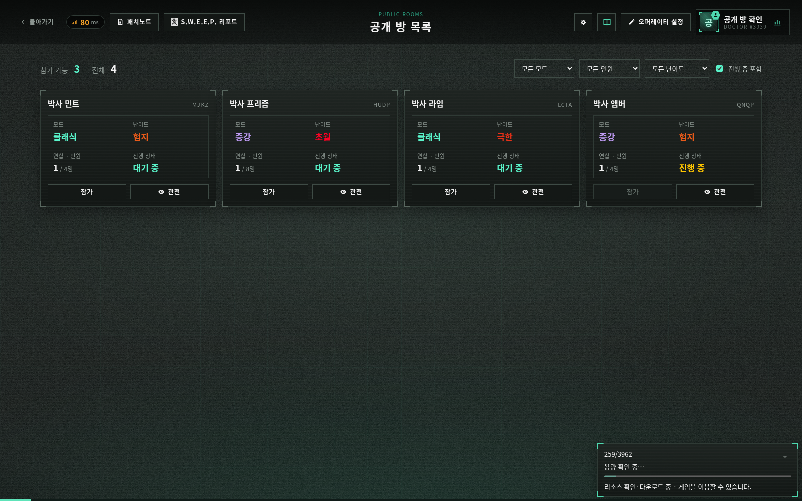

# 공개 방과 모드 안내

실제 로컬 서버와 브라우저에서 방을 생성하고 공개한 뒤 촬영했습니다. 이미지에 보이는 방 이름은 화면 검증용 데이터이며 실제 이용자의 방이 아닙니다.

- 모드/실험실/연습실: 기존 공통 툴팁을 버튼 아래에 표시. 설명은 핵심 규칙만 안내.
- 공개 방: 기본 비공개. 방장만 클래식·증강에서 확인창을 거쳐 공개 가능. 공개 후 비공개 전환과 커스텀 선택은 서버에서도 차단. 저장된 커스텀 설정은 유지.
- 방 목록: 로비와 분리된 전용 페이지. 방제 설정 없이 방장 닉네임, 모드, 난이도, 인원/AI, 대기·진행 상태, 참가·관전. 모드·인원·난이도 필터, 진행 중 포함 선택. 10초 자동 갱신, 참가 가능한 방 수/전체 방 수 표시.
- 배치: 한 줄에 4개인 카드형으로 확정. 작은 화면에서는 2열/1열로 줄여 표시.
- 기존 단독 방의 참가·관전 제한은 유지. 목록은 접속한 게임 서버 버전의 공개 방을 표시.

## 실제 화면

[이전 배치 후보](layout-candidates.png)

[로비](lobby.png) · [모드 안내](mode-tooltip.png) · [실험실 안내](laboratory-tooltip.png) · [공개 전환 확인](publish-confirmation.png)

## 확인

- `node --test test/public-rooms.test.js`: 공개 기본값, 공개 권한, 비공개 노출 방지, 커스텀 전환 차단, 진행 상태.
- `SP_E2E=1 node --test test/ui/public-rooms.browser.test.js`: 실제 필터, 카드 4열, 방 수 집계, 10초 자동 갱신, 관전 진입, 툴팁, 확인창, 공개 후 선택 제한. 화면도 해당 테스트에서 촬영.
- `node --test test/gameplay-modes.test.js`: 기존 모드/저장 설정 보존 검증 5건.
- `SP_E2E=1 node --test test/ui/navigation-consistency.browser.test.js`: 기존 상단바/설정/모드 전환 회귀 확인.
