# 설정·전투 통계 UI 실제 브라우저 비교

촬영일: 2026-10-20 (한국 시간). 변경 전 기준: `a10932dc`.

Chromium에서 실제 `CustomExtensionsDialog`, `CombatReport`, `CombatMetricsPanel` 컴포넌트를 렌더링하고 스크린샷을 촬영했습니다. 합성 시안이나 이미지 생성 결과가 아닙니다. 비교에는 동일한 검증용 전투 데이터와 실제 제작 데이터·오퍼레이터 초상화를 사용했습니다. 운영 서버의 플레이 기록을 촬영한 것은 아닙니다.

PC는 1440×1000, 모바일은 390×844입니다. 변경 전 화면은 기준 커밋의 JavaScript·CSS를 별도 브라우저 컨텍스트에서 제공했으며 작업 파일을 되돌리지 않았습니다. 전투 데이터는 참가자 2명·3개 라운드·12개 오퍼레이터로 같고, 전투 규칙이나 서버 기록 형식은 변경하지 않았습니다.

## 변경 전·후

### 커스텀 설정 · PC

긴 설명에 따라 달라지던 카드 높이를 112px로 고정하고, 설명을 버튼으로 펼치도록 변경했습니다. 일반 전투 시간처럼 복합 입력이 필요한 항목은 별도 높이를 사용합니다.

| 변경 전 | 변경 후 |
|---|---|
| 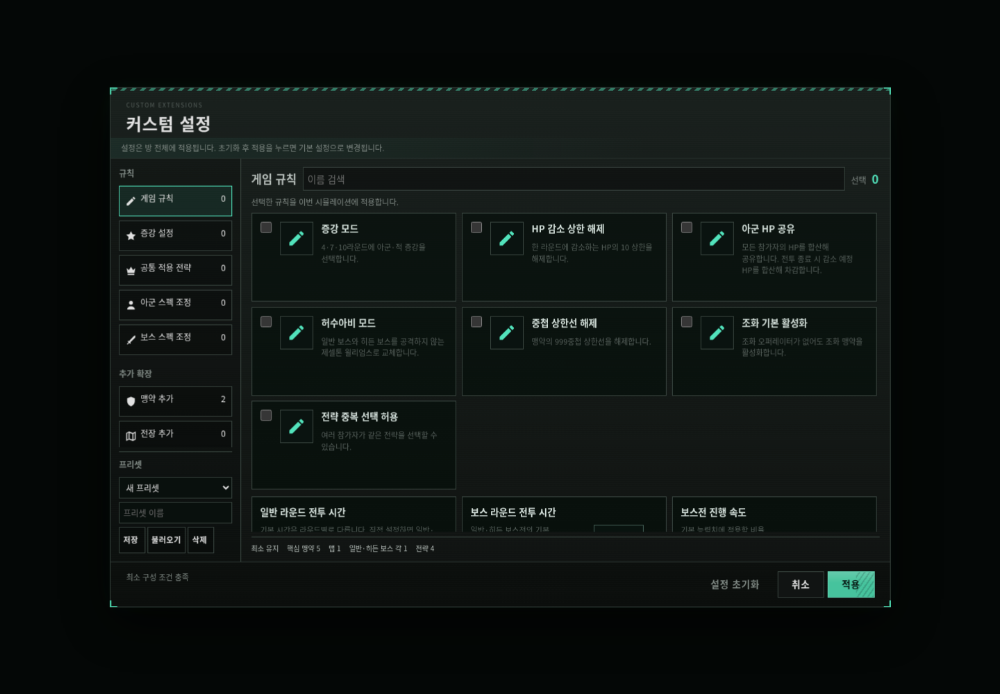 | 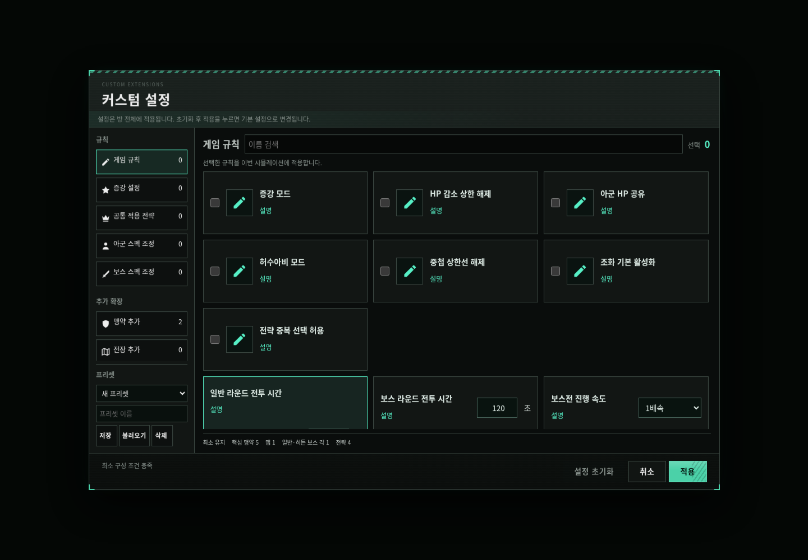 |

### 기록 통계 · PC

핵심 수치 4개와 상위 8개 순위를 기본 간소 보기로 정리했습니다. 어두운 패널과 민트색 선택 상태를 설정 테마와 맞췄습니다.

| 변경 전 | 변경 후 |
|---|---|
| 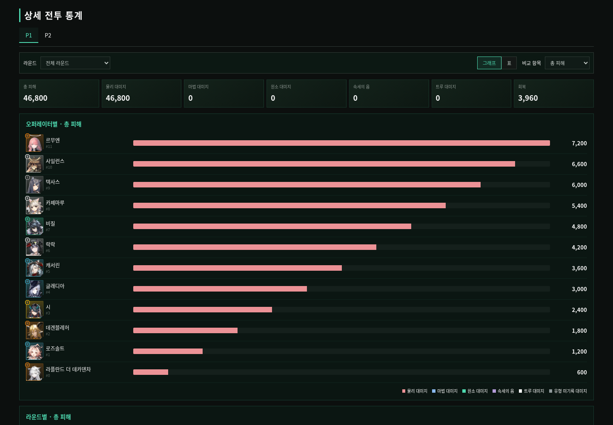 | 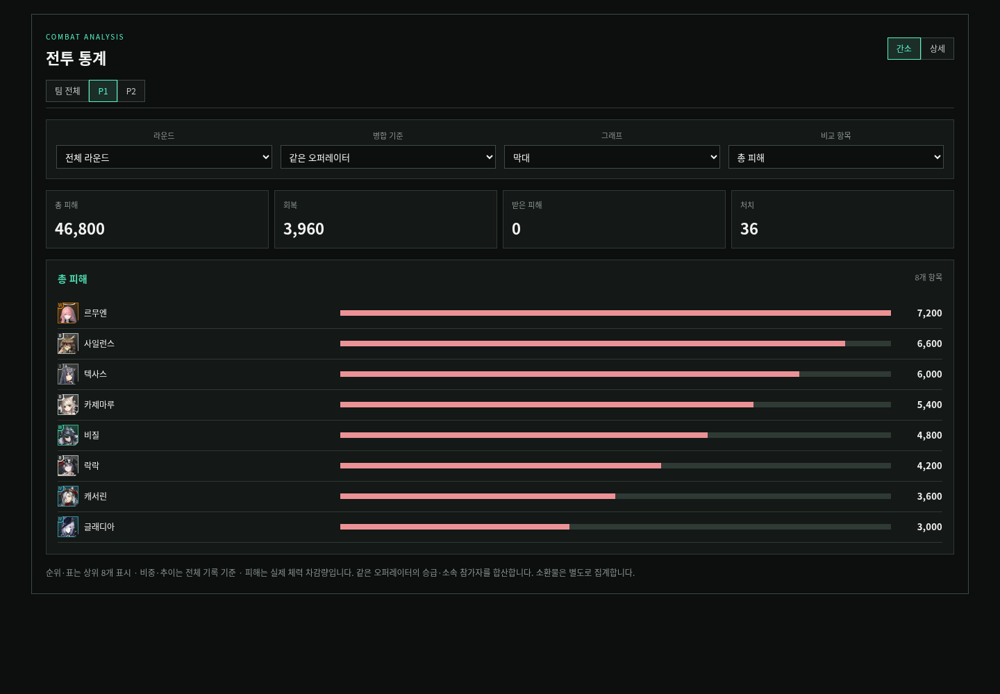 |

### 실시간 통계 · PC

간소/상세 전환과 피해·회복·중첩·DPS·HPS·중첩/초 선택을 추가했습니다. 병합·막대/비중 보기를 지원합니다.

| 변경 전 | 변경 후 |
|---|---|
| 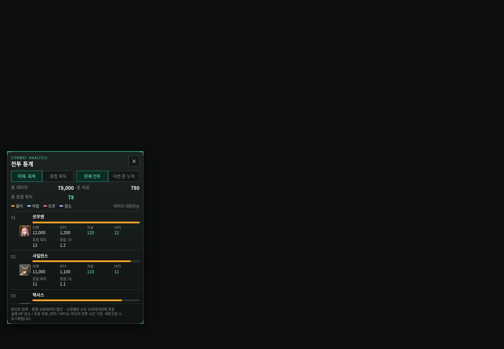 | 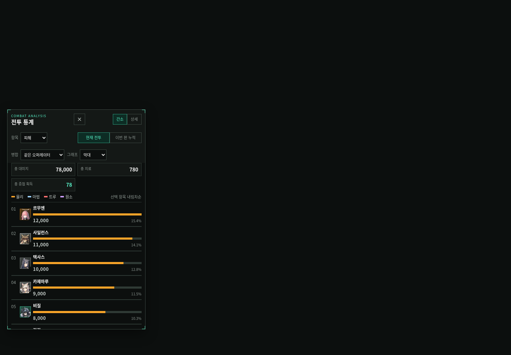 |

### 커스텀 설정 · 모바일

카드 너비와 입력 영역이 화면을 벗어나지 않게 하고, 분류 메뉴는 가로 스크롤 한 줄로 정리했습니다.

| 변경 전 | 변경 후 |
|---|---|
| 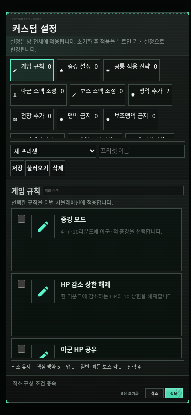 | 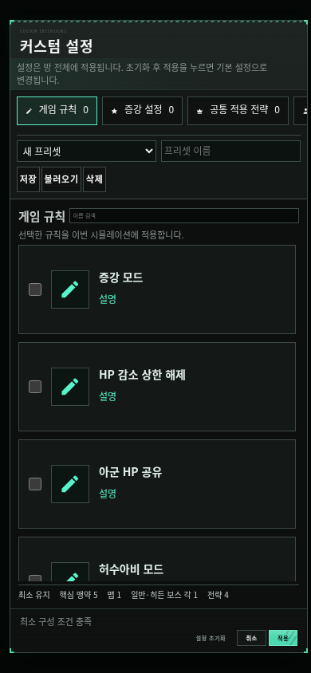 |

### 기록 통계 · 모바일

좁은 화면에서는 선택 도구와 요약 카드가 줄을 바꾸며, 긴 통계 표는 해당 영역 안에서만 가로로 스크롤합니다.

| 변경 전 | 변경 후 |
|---|---|
| 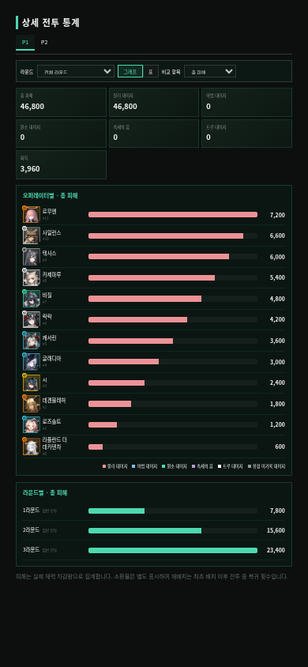 | 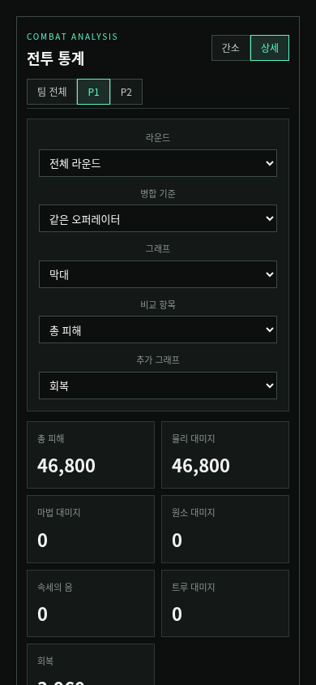 |

### 실시간 통계 · 모바일

늘어난 제어부가 순위를 가리지 않도록 패널 높이와 스크롤을 조정했습니다.

| 변경 전 | 변경 후 |
|---|---|
| 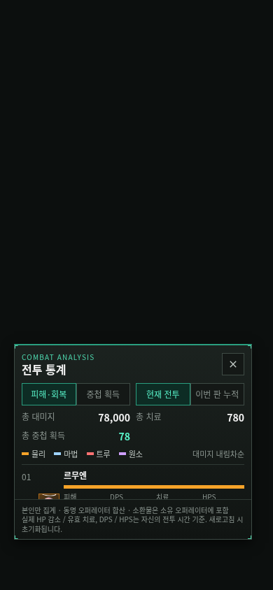 | 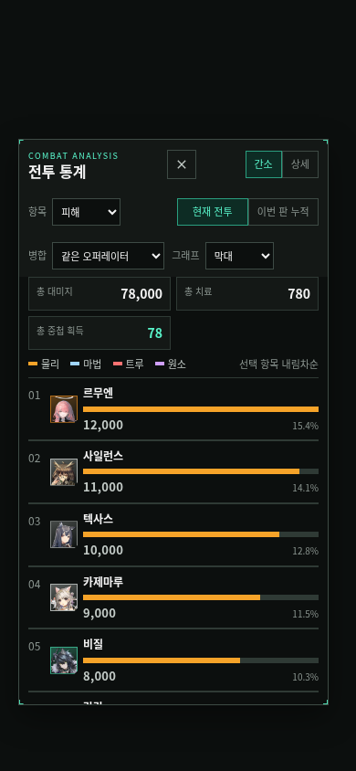 |

## 새 상세 화면

| 상세 보기 · 두 개의 라운드 추이 그래프 | 기여 비중 그래프 |
|---|---|
| 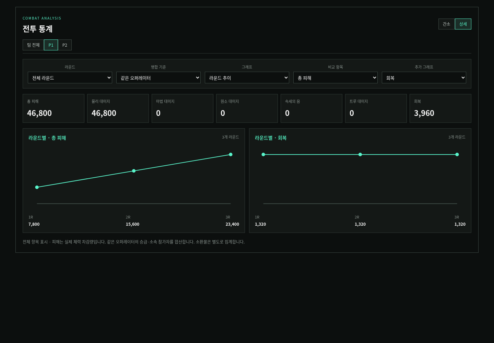 | 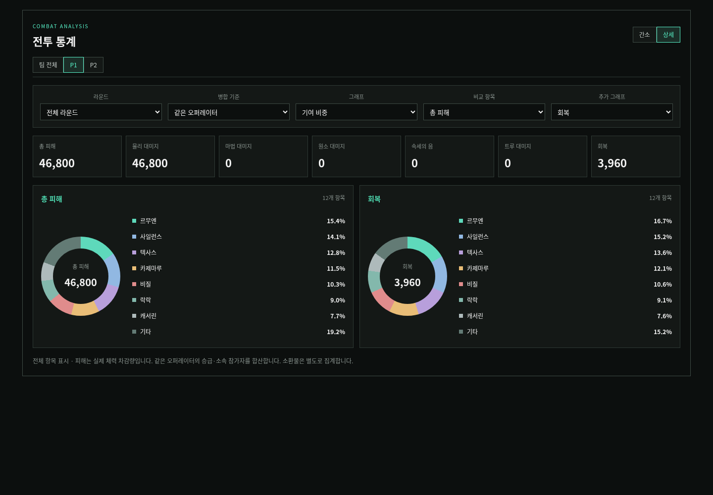 |

## 제공하는 보기

- 기록 통계: 간소 / 상세, 팀 전체 / 참가자 선택, 라운드 선택, 막대 / 기여 비중 / 라운드 추이 / 표.
- 상세 보기: 두 번째 비교 항목을 선택해 그래프 두 개를 함께 표시하거나 추가 그래프를 끌 수 있습니다.
- 기록 병합: 개별 유닛 / 같은 오퍼레이터 / 직군 / 단계 / 오퍼레이터·소환물 / 참가자.
- 실시간 병합: 기존 수집 단위의 제한에 맞춰 같은 오퍼레이터 / 직군 / 단계 / 오퍼레이터·소환물. 소환물 기여는 기존처럼 소유 오퍼레이터에 포함됩니다.
- 간소 순위·표는 상위 8개만 표시하며 요약 합계·기여 비중·라운드 추이는 전체를 기준으로 합니다. 상세 보기에서는 전체 순위를 표시합니다.
- 간소/상세 선택은 화면별로 저장됩니다. 기록 통계에 저장되지 않은 과거 중첩 획득량이나 시간별 곡선을 새로 추정해 만들지 않습니다. 중첩 획득량은 기존 실시간 수집 자료를 사용합니다.

## 검증

병합 6종의 총합 보존, 참가자 간 동일 유닛 번호 분리, 소환물 별도 분류, 제외된 라운드 미집계, 비중의 합과 기타 항목 보존, 실시간 초당 수치의 분모를 검증했습니다. 브라우저에서는 간소/상세 전환·그래프·병합 선택·카드 높이·설명 버튼의 체크 상태 보존·모바일 가로 넘침·순위 행의 실제 노출을 검사했습니다.

재현: `SP_E2E=1 SP_COMPARE_SCREENSHOTS=1 node --test test/ui/analysis-panels.browser.test.js`. 초상화가 로컬에 없는 환경에서는 `/tmp/analysis-panel-assets`에 기존 리소스 목록이 지정한 원본 초상화 12개를 준비해야 비교 촬영의 이미지 로드 대기 조건을 만족합니다. 일반 UI 검증은 `SP_COMPARE_SCREENSHOTS` 없이 실행할 수 있습니다.
